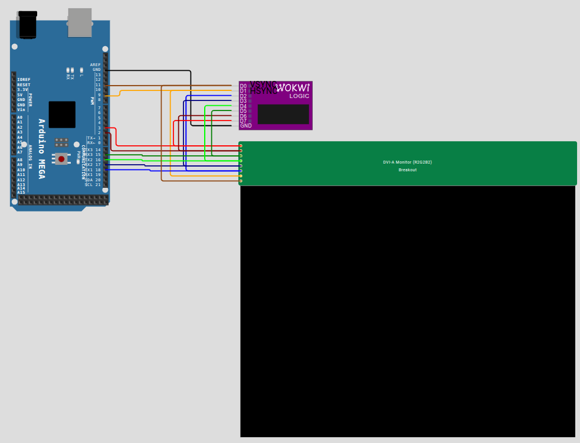

# Wokwi DVI-A / VGA Monitor Custom Chip (`dvia-monitor`)

A [Wokwi Custom Chip](https://docs.wokwi.com/chips-api/getting-started) simulation model for a simulated DVI-A / VGA monitor displaying up to 64 colors (R2G2B2) with resolutions up to 800x600 (default 640x480).

---

## Overview

The DVI-A Monitor Chip emulates an analog RGB display receiving discrete digital color signals (2 bits per Red, Green, and Blue channel) alongside standard horizontal (`HSYNC`) and vertical (`VSYNC`) sync pulses:
* **Color Depth**: 6-bit color (2-bit R, 2-bit G, 2-bit B) yielding 64 distinct colors, expanded internally to 24-bit RGB.
* **Resolution**: Native 640x480 frame buffer rendered directly to Wokwi's display canvas.
* **Timing & Autosync**: Samples line start and line end on HSYNC edges, calculates pixel clock dynamically, and flips the backbuffer on VSYNC rising edge.

---

## Pinout

| Pin Name | Direction | Description |
| :--- | :--- | :--- |
| `R0` | Input | Red channel bit 0 (LSB). |
| `R1` | Input | Red channel bit 1 (MSB). |
| `G0` | Input | Green channel bit 0 (LSB). |
| `G1` | Input | Green channel bit 1 (MSB). |
| `B0` | Input | Blue channel bit 0 (LSB). |
| `B1` | Input | Blue channel bit 1 (MSB). |
| `HSYNC`| Input | Horizontal synchronization pulse. |
| `VSYNC`| Input | Vertical synchronization pulse. |

---

## Usage in Wokwi

### 1. Add as a Project Dependency

To include the DVI-A monitor in your Wokwi project, add it under `dependencies` in your `diagram.json`:

```json
{
  "version": 1,
  "author": "Your Name",
  "editor": "wokwi",
  "parts": [
    {
      "type": "dvia-monitor",
      "id": "monitor1",
      "top": 100,
      "left": 300,
      "attrs": {}
    }
  ],
  "connections": [
    [ "mega:11", "monitor1:VSYNC", "brown", [] ],
    [ "mega:9",  "monitor1:HSYNC", "orange", [] ],
    [ "mega:30", "monitor1:R1", "red", [] ],
    [ "mega:31", "monitor1:G1", "green", [] ],
    [ "mega:1",  "monitor1:B1", "blue", [] ]
  ],
  "dependencies": {
    "dvia-monitor": "github:Bmiga-1200/wokwi-chip-r2g2b2-monitor@1.0.0"
  }
}
```

---

## Wiring Diagram

Connect the video generation pins (such as from an Arduino Mega running VGAXUA, Raspberry Pi Pico using PicoVGA, or ESP32-S3) through current-limiting resistors to the color and sync pins:



---

## Example Test Sketch (Arduino Mega + VGAXUA)

The test sketch under `tests/Pattern/Pattern.ino` demonstrates driving the monitor with test patterns using the `VGAXUA` library:

```cpp
#include <VGAXUA.h>

VGAXUA vga;

void setup() {
  vga.begin();
  vga.clear(0);

  // Draw color stripes
  for (int y = 0; y < 120; y++) {
    for (int x = 0; x < 160; x++) {
      vga.putpixel(x, y, (x / 20) % 4);
    }
  }
}

void loop() {
  // Pattern display loop
}
```

---

## Development & Building

### Prerequisites
* [WASI SDK](https://github.com/WebAssembly/wasi-sdk)
* `make`
* `arduino-cli` (for test execution)

### Build WASM Binary
```bash
make
```

### Run Automated Tests
```bash
make test
```
The test compiles the `Pattern` test sketch targeting Arduino Mega with the `VGAXUA` library installed.

---

## License

This project is licensed under the [GNU Affero General Public License v3.0 (AGPL-3.0)](https://www.gnu.org/licenses/agpl-3.0.html).
